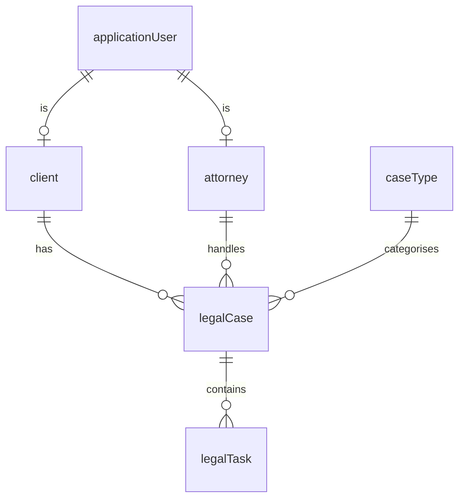

# Justice Law Attorneys: Law Firm Management System

A full-stack web application for managing a law firm's clients, attorneys, cases and tasks. It has an **ASP.NET Core 8 Web API** backend with a **SQL Server** database and a **React** frontend. Access is role-based, with separate experiences for **Admins**, **Attorneys** and **Clients**.

A group project for IWDV202: Web Applications Development

<!--  -->

---

## Features

- **Role-based access** (Admin, Attorney, Client) using ASP.NET Core Identity and JWT authentication
- **Client management**: register and maintain client records
- **Attorney management**: maintain attorney profiles
- **Case management**: create and track legal cases by case type
- **Task management**: assign and track tasks within each case
- **Search endpoints** for finding attorneys, clients and cases
- **Task lookup by case**: fetch every task that belongs to a given case

---

## Tech Stack

| Layer | Technology |
| --- | --- |
| Backend | ASP.NET Core 8 Web API (C#) |
| ORM | Entity Framework Core (Code-First, migrations) |
| Database | Microsoft SQL Server |
| Authentication | ASP.NET Core Identity with JWT (Admin / Attorney / Client roles) |
| Frontend | React (Vite) with React-Bootstrap |
| Version control | Git and GitHub |

---

## Database Design

The database is built Code-First with EF Core. The main tables are:

| Table | Purpose |
| --- | --- |
| `applicationUser` | Login accounts (extends ASP.NET Identity) |
| `client` | Client details |
| `attorney` | Attorney details |
| `caseType` | Categories of legal case |
| `legalCase` | An individual case |
| `legalTask` | A task belonging to a case |

---

## Roles

| Role | What they can do |
| --- | --- |
| **Admin** | Manage users, attorneys, clients, case types and cases, and create logins for attorneys and clients |
| **Attorney** | View and manage their assigned cases and tasks |
| **Client** | View their own cases and progress |

---

## API Overview

The API is documented with Swagger UI. Endpoints are protected with JWT authentication: users log in to receive a token, and new logins are created by an Admin.

### Auth

| Method | Endpoint | Description |
| --- | --- | --- |
| `POST` | `/api/Auth/register` | Create a login for an attorney or client record (Admin only) |
| `POST` | `/api/Auth/login` | Log in and receive a token |

### Me

| Method | Endpoint | Description |
| --- | --- | --- |
| `GET` | `/api/Me` | Get the currently logged-in user |

### Attorneys

| Method | Endpoint | Description |
| --- | --- | --- |
| `GET` | `/api/Attorneys` | List attorneys |
| `POST` | `/api/Attorneys` | Create an attorney |
| `GET` | `/api/Attorneys/{id}` | Get one attorney |
| `PUT` | `/api/Attorneys/{id}` | Update an attorney |
| `DELETE` | `/api/Attorneys/{id}` | Delete an attorney |
| `GET` | `/api/Attorneys/search` | Search attorneys |

### Clients

| Method | Endpoint | Description |
| --- | --- | --- |
| `GET` | `/api/Clients` | List clients |
| `POST` | `/api/Clients` | Create a client |
| `GET` | `/api/Clients/{id}` | Get one client |
| `PUT` | `/api/Clients/{id}` | Update a client |
| `DELETE` | `/api/Clients/{id}` | Delete a client |
| `GET` | `/api/Clients/search` | Search clients |

### Cases

| Method | Endpoint | Description |
| --- | --- | --- |
| `GET` | `/api/Cases` | List cases |
| `POST` | `/api/Cases` | Create a case |
| `GET` | `/api/Cases/{id}` | Get one case |
| `PUT` | `/api/Cases/{id}` | Update a case |
| `DELETE` | `/api/Cases/{id}` | Delete a case |
| `GET` | `/api/Cases/search` | Search cases |

### Case Types

| Method | Endpoint | Description |
| --- | --- | --- |
| `GET` | `/api/CaseTypes` | List case types |
| `POST` | `/api/CaseTypes` | Create a case type |
| `GET` | `/api/CaseTypes/{id}` | Get one case type |
| `PUT` | `/api/CaseTypes/{id}` | Update a case type |
| `DELETE` | `/api/CaseTypes/{id}` | Delete a case type |

### Legal Tasks

| Method | Endpoint | Description |
| --- | --- | --- |
| `GET` | `/api/LegalTasks` | List tasks |
| `POST` | `/api/LegalTasks` | Create a task |
| `GET` | `/api/LegalTasks/{id}` | Get one task |
| `PUT` | `/api/LegalTasks/{id}` | Update a task |
| `DELETE` | `/api/LegalTasks/{id}` | Delete a task |
| `GET` | `/api/LegalTasks/case/{caseId}` | List all tasks for a case |

---

## Team

| Member | Responsibility |
| --- | --- |
| Vuyisanani | API and search endpoints |
| Katlego | Database, models, Identity and roles |
| Bandiswa | React frontend: Admin side |
| Molefi | React frontend: Attorney and Client side |

---

## What We Learned

- Designing a relational schema and building it Code-First with EF Core migrations
- Securing an API with ASP.NET Core Identity, JWT and role-based authorisation
- Collaborating as a team of four using Git and GitHub

---

## Licence

This project was created for educational purposes.