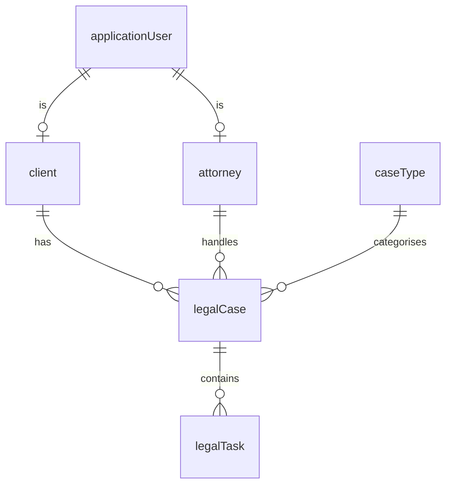

# Justice Law Attorneys: Law Firm Management System

A full-stack web application for managing a law firm's clients, attorneys, cases and tasks. It has an **ASP.NET Core 8 Web API** backend with a **SQL Server** database and a **React** frontend. Access is role-based, with separate experiences for **Admins**, **Attorneys** and **Clients**.

A group project for IWDV202: Web Applications Development

<!--  -->

---

## Features

- **Role-based access** (Admin, Attorney, Client) using ASP.NET Core Identity
- **Client management**: register and maintain client records
- **Attorney management**: maintain attorney profiles
- **Case management**: create and track legal cases by case type
- **Task management**: assign and track tasks within each case
- **Search endpoints** for finding attorneys, clients and cases
- **Task lookup by case**: fetch every task that belongs to a given case

---

## Tech Stack

| Layer | Technology |
| --- | --- |
| Backend | ASP.NET Core 8 Web API (C#) |
| ORM | Entity Framework Core (Code-First, migrations) |
| Database | Microsoft SQL Server |
| Authentication | ASP.NET Core Identity (Admin / Attorney / Client roles) |
| Frontend | React with React-Bootstrap |
| Version control | Git and GitHub |

---

## Repository Structure

```
justice-law-system/
├── JusticeLaw.API/          # ASP.NET Core 8 Web API
└── justice-law-client/      # React frontend
```

---

## Database Design

The database is built Code-First with EF Core. The main tables are:

| Table | Purpose |
| --- | --- |
| `applicationUser` | Login accounts (extends ASP.NET Identity) |
| `client` | Client details |
| `attorney` | Attorney details |
| `caseType` | Categories of legal case |
| `legalCase` | An individual case |
| `legalTask` | A task belonging to a case |



---

## Getting Started

### Prerequisites

- [.NET 8 SDK](https://dotnet.microsoft.com/download/dotnet/8.0)
- [Node.js](https://nodejs.org/) (LTS) and npm
- SQL Server (LocalDB, Express or full) and a tool such as SSMS or Azure Data Studio
- Visual Studio 2022 (recommended for the API) or the .NET CLI

### 1. Clone the repository

```bash
git clone https://github.com/katlegostuart/justice-law-system.git
cd justice-law-system
```

### 2. Set up the database and API

1. Open `JusticeLaw.API/appsettings.json` and set your SQL Server connection string:

   ```json
   "ConnectionStrings": {
     "DefaultConnection": "Server=(localdb)\\MSSQLLocalDB;Database=JusticeLawDb;Trusted_Connection=True;"
   }
   ```

2. Apply the migrations to create the database:

   ```bash
   cd JusticeLaw.API
   dotnet ef database update
   ```

   In Visual Studio you can instead run `Update-Database` in the Package Manager Console.

3. Start the API:

   ```bash
   dotnet run
   ```

   The API will start on the URL shown in the console (Swagger UI is available at `/swagger` if enabled).

### 3. Run the frontend

```bash
cd justice-law-client
npm install
npm run dev
```

Make sure the API base URL in the frontend config matches the URL your API is running on.

---

## Roles

| Role | What they can do |
| --- | --- |
| **Admin** | Manage users, attorneys, clients, case types and cases |
| **Attorney** | View and manage their assigned cases and tasks |
| **Client** | View their own cases and progress |

---

## API Overview

Interactive documentation is available through Swagger UI when the API is running.

### Using the API in Swagger

Most endpoints are protected, so log in first:

1. Call `POST /api/Auth/register` to create an account, or use an existing one.
2. Call `POST /api/Auth/login` and copy the token from the response.
3. Click the **Authorize** button at the top of the Swagger page and paste the token in.
4. The padlocks now apply to your requests, and you can call the protected endpoints.

### Auth

| Method | Endpoint | Description |
| --- | --- | --- |
| `POST` | `/api/Auth/register` | Register a new user |
| `POST` | `/api/Auth/login` | Log in |

### Me

| Method | Endpoint | Description |
| --- | --- | --- |
| `GET` | `/api/Me` | Get the currently logged-in user |

### Attorneys

| Method | Endpoint | Description |
| --- | --- | --- |
| `GET` | `/api/Attorneys` | List attorneys |
| `POST` | `/api/Attorneys` | Create an attorney |
| `GET` | `/api/Attorneys/{id}` | Get one attorney |
| `PUT` | `/api/Attorneys/{id}` | Update an attorney |
| `DELETE` | `/api/Attorneys/{id}` | Delete an attorney |
| `GET` | `/api/Attorneys/search` | Search attorneys |

### Clients

| Method | Endpoint | Description |
| --- | --- | --- |
| `GET` | `/api/Clients` | List clients |
| `POST` | `/api/Clients` | Create a client |
| `GET` | `/api/Clients/{id}` | Get one client |
| `PUT` | `/api/Clients/{id}` | Update a client |
| `DELETE` | `/api/Clients/{id}` | Delete a client |
| `GET` | `/api/Clients/search` | Search clients |

### Cases

| Method | Endpoint | Description |
| --- | --- | --- |
| `GET` | `/api/Cases` | List cases |
| `POST` | `/api/Cases` | Create a case |
| `GET` | `/api/Cases/{id}` | Get one case |
| `PUT` | `/api/Cases/{id}` | Update a case |
| `DELETE` | `/api/Cases/{id}` | Delete a case |
| `GET` | `/api/Cases/search` | Search cases |

### Case Types

| Method | Endpoint | Description |
| --- | --- | --- |
| `GET` | `/api/CaseTypes` | List case types |
| `POST` | `/api/CaseTypes` | Create a case type |
| `GET` | `/api/CaseTypes/{id}` | Get one case type |
| `PUT` | `/api/CaseTypes/{id}` | Update a case type |
| `DELETE` | `/api/CaseTypes/{id}` | Delete a case type |

### Legal Tasks

| Method | Endpoint | Description |
| --- | --- | --- |
| `GET` | `/api/LegalTasks` | List tasks |
| `POST` | `/api/LegalTasks` | Create a task |
| `GET` | `/api/LegalTasks/{id}` | Get one task |
| `PUT` | `/api/LegalTasks/{id}` | Update a task |
| `DELETE` | `/api/LegalTasks/{id}` | Delete a task |
| `GET` | `/api/LegalTasks/case/{caseId}` | List all tasks for a case |

---

## Team

| Member | Responsibility |
| --- | --- |
| Vuyisanani | API and search endpoints |
| Katlego | Database, models, Identity and roles |
| Bandiswa | React frontend: Admin side |
| Molefi | React frontend: Attorney and Client side |

---

## What We Learned

- Designing a relational schema and building it Code-First with EF Core migrations
- Securing an API with ASP.NET Core Identity and role-based authorisation
- Collaborating as a team of four using Git and GitHub

---

## Licence

This project was created for educational purposes.
